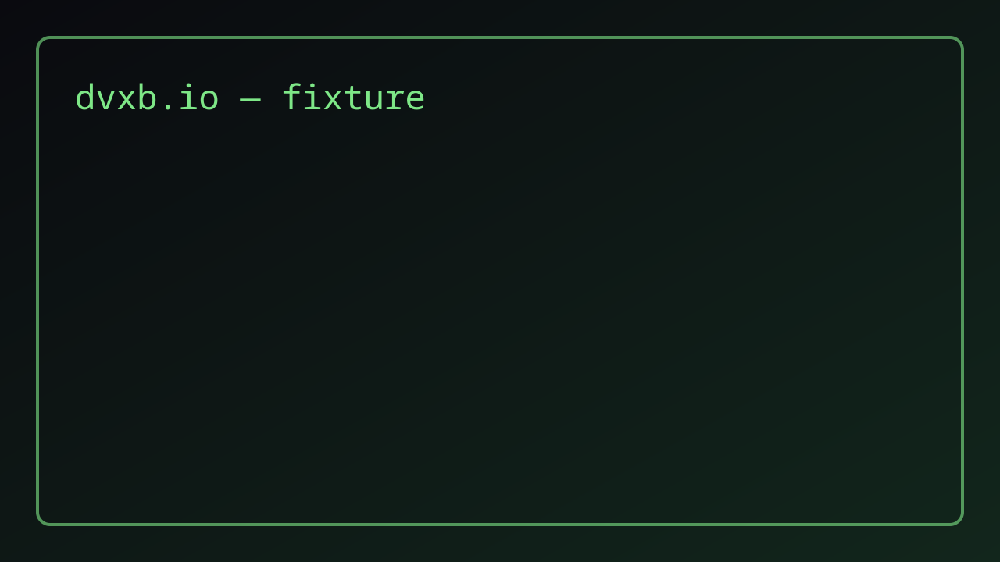

This is a **fixture draft**. It exists only to verify the draft gate:
prod builds emit zero bytes for it, `BUILD_DRAFTS=1` renders it under
`blog/draft/<sha12>/` with `noindex`.

```js
const drafts = posts.filter((p) => p.draft);
console.log(`skipped ${drafts.length} draft(s)`);
```

## Why this exists

Steps 5–6 exercise the read-UX slots (TOC, share footer, OG) and the
sharp image island against this draft. These headings exist so the
build-time TOC has something to list.



### Gate semantics

Same gate as the skeleton: `draft:true` means zero bytes in prod,
hash URL + `noindex` under `BUILD_DRAFTS=1`.

## Second section

A second `h2` keeps the TOC honest about multi-entry lists.
